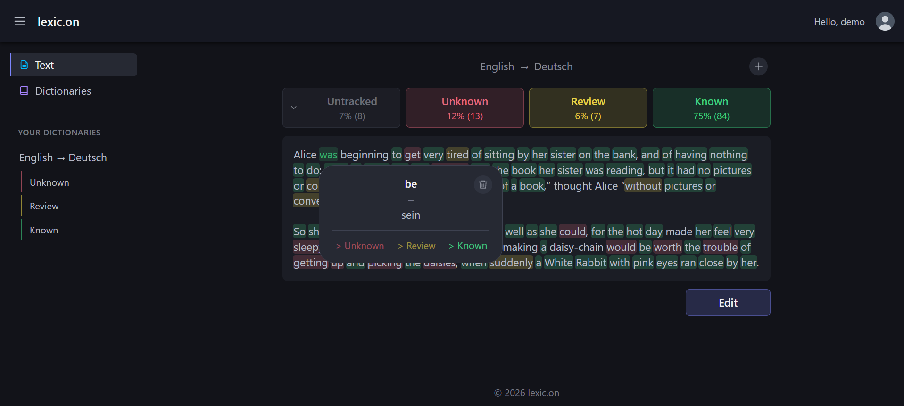

# lexic.on

**lexic.on** is a web app for learning vocabulary while reading texts in a foreign language.

Paste a text, read it in the app, and click any word to see its translation. Build your personal vocabulary as you go: words are highlighted by status (Unknown / Review / Known), and different grammatical forms of the same word are recognized as one entry.

**Live demo:** https://lexic-on.onrender.com/ — hosted on Render's free plan, so the first request after a period of inactivity can take up to a minute while the service wakes up.

This is a capstone project and is under active development.

## Features

- **Reading without an account:** paste a text, pick the source and target language, and click any word to see its translation in a popup. Different forms of a word (`went`, `going`) are reduced to one dictionary form.
- **Personal vocabulary:** after logging in with GitHub, mark words as Unknown, Review or Known. The text is highlighted by status, and a stats bar shows how much of it you already know.
- **Dictionaries:** a separate section lists your words per language pair and status, where you can change a status, delete a word or add all untracked words from the current text at once.
- **Interface languages:** the interface is available in English, German and Ukrainian. It is switched at the bottom of the sidebar; the first visit follows the browser language and the choice is remembered.

## Supported languages

At the current stage of development only these language pairs work:

- English → German
- English → Ukrainian

Texts must be in English; the target language is chosen on the Text page.

## Screenshots

Reading a text with words highlighted by status, a stats bar and a translation popup with status buttons:



## Tech stack

**Backend** (`backend/`)
- Java 25, Spring Boot
- PostgreSQL (hosted on [Neon](https://neon.tech)), Spring Data JPA / Hibernate, Flyway migrations
- Spring Security with OAuth2 login
- LanguageTool (embedded, offline) for tokenization/lemmatization
- Azure Translator for translations

**Frontend** (`frontend/`)
- React, TypeScript, Vite
- Tailwind CSS, React Router
- react-i18next for the interface translations

In production the frontend is built to static files and served by the Spring Boot backend as a single deployable app.

## Local development

### Backend

Requires a PostgreSQL database (a free [Neon](https://neon.tech) project works well) and Java 25.

```bash
cd backend
./mvnw spring-boot:run   # mvnw.cmd on Windows
```

Secrets are not committed to the repo. Provide them either as environment variables or in a git-ignored `backend/src/main/resources/application-local.properties` (picked up automatically, no profile needed; copy `application-local.properties.example` next to it as a starting point). The properties are referenced from `application.properties`:

- `DB_URL`, `DB_USER`, `DB_PASSWORD` — PostgreSQL connection
- `AZURE_TRANSLATOR_KEY`, `AZURE_TRANSLATOR_REGION` — Azure Translator
- `GITHUB_CLIENT_ID`, `GITHUB_CLIENT_SECRET` — GitHub OAuth2 login
- `GOOGLE_CLIENT_ID`, `GOOGLE_CLIENT_SECRET` — Google OpenID Connect login

Tests need none of these: they run against an in-memory H2 database and a mocked Azure client.

### Frontend

```bash
cd frontend
npm install
npm run dev
```

## Repository structure

```
lexic-on/
├── backend/                 Spring Boot API
│   └── src/main/java/com/lexicon/backend/
│       ├── client/          external APIs (Azure Translator, GitHub)
│       ├── config/          web configuration
│       ├── controller/      REST endpoints and SPA route forwarding
│       ├── dto/             request/response objects
│       ├── enums/           languages, vocabulary statuses, user roles
│       ├── exception/       domain exceptions
│       ├── model/           JPA entities and converters
│       ├── repository/      Spring Data repositories
│       ├── security/        OAuth2 login, session and CSRF setup
│       └── service/         business logic
├── frontend/                React + Vite SPA
│   └── src/
│       ├── api/             backend requests
│       ├── components/      UI components
│       ├── hooks/           React hooks
│       ├── lib/             helpers
│       ├── locales/         interface translations (en, de, uk)
│       ├── pages/           routed pages
│       └── types/           TypeScript types
├── .github/                 CI (tests, lint, SonarCloud) and deploy workflows
├── Dockerfile               production image (runs the built backend jar)
└── sonar-project.properties SonarCloud settings
```

## Privacy

[Privacy policy](https://lexic-on.onrender.com/privacy.html)
